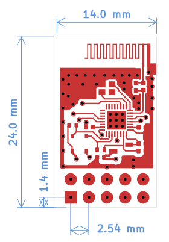

SDC-LE-02HD
^^^^^^^^^^^^^^^^^^^^^^^^^^^^^^^^^^^^^^^^^
AB5602B核心，蓝牙双模设计，主打音频功能，适配带音频输出的消费电子。采用插件接口，支持3.0V~6V供电（典型5V），串口兼容3.3V/5V电平。

.. list-table::
   :widths: 1 1
   :header-rows: 0

   * - .. image:: images/sdc-le-02hd-img1.png
         :width: 200
         :alt: SDC-LE-02HD 模组正面图
     - .. image:: images/sdc-le-02hd-img2.png
         :width: 200
         :alt: SDC-LE-02HD 模组反面

核心性能
~~~~~~~~~~
- 处理器：32位RISC-V CPU，125MHz主频
- 存储：4Mbit Flash + 128KB RAM
- 蓝牙射频：BT5.4双模（QDID:215269），发射6dBm，接收-90.5dBm@EDR（2M带宽）
- 音频功能：16bit立体声、软件EQ均衡器、1段DRC动态范围压缩，1路MIC输入，左右声道差分输出
- 扩展功能：UART串口、MUTE静音控制
- 典型供电：3.0V~6V供电（典型5V）
- 工作温度：-40℃~85℃
- 封装尺寸: 24mmx14mm(插件接口)

关键引脚定义
~~~~~~~~~~~~~~~~~~~~~~~~~

.. list-table:: 关键引脚定义
   :widths: 15 20 45 20
   :header-rows: 1

   * - 引脚
     - 信号名
     - 描述
     - 引脚类型
   * - PB1
     - AUDIO
     - 音频连接后输出低电平,最大耐压3.6V
     - O（输出）
   * - PE0
     - MUTE
     - 静音控制引脚,低电平时静音
     - O（输出）
   * - AGND
     - AGND
     - 模块地
     - P（电源）
   * - DACL
     - M DACL
     - 左声道音频输出
     - O（输出）
   * - DACR
     - M DACR
     - 右声道音频输出
     - O（输出）
   * - PB0
     - APP
     - app连接后输出低电平,最大耐压3.6V
     - O（输出）
   * - VDD
     - VDD
     - 电源正极，3.0V~6V供电（典型5V）
     - P（电源）
   * - GND
     - GND
     - 电源地
     - P（电源）
   * - (RX)PE6
     - UART_RX
     - 串口RX数据接收端,3.3V/5V电平兼容
     - I（输入）
   * - (TX)PE7
     - UART_TX
     - 串口TX数据发送端,3.3V/5V电平兼容
     - O（输出）

极限参数
~~~~~~~~~~

.. list-table:: 极限参数
   :widths: 20 30 20 10
   :header-rows: 1

   * - 参数
     - 说明
     - 范围
     - 单位
   * - VDD
     - 稳态电源电压
     - 3.0 ~ 6.0
     - V
   * - VDDIO 
     - I/O 电源电压
     - 3.3
     - V
   * - Tamb
     - 工作温度
     - -40~+85
     - ℃
   * - Tstg
     - 储藏温度
     - -65~+150
     - ℃
   * - Ground
     - 地
     - -0.3~0.3
     - V
   * - Voh
     - 数字输出高电平
     - VDDIO-0.3 ~ VDDIO+0.3
     - V
   * - Vol
     - 数字输出低电平
     - <0.4
     - V
   * - Ioh
     - 拉电流
     - 8~32
     - mA
   * - Iol
     - 灌电流
     - 8~32
     - mA
   * - Vih
     - 数字输入高电平
     - ≥0.7×VDDIO
     - V
   * - ViL
     - 数字输入低电平
     - ≤0.3×VDDIO
     - V

串口通信协议
~~~~~~~~~~~~~~~~~~~~~~~~~~

器材 MCU 侧的串口帧格式、波特率自适应、命令集与典型交互流程，见 :doc:`../../protocol/serial-protocol`。

认证证书
~~~~~~~~~~
- **CE-RED**：符合欧盟无线电设备指令，通过CE认证
  - 下载链接：`CE-RED证书 <certificates/sdc-le-02hd-ce-red.pdf>`_
- **FCC**：符合美国联邦通信委员会标准，通过FCC认证
  - 下载链接：`FCC证书（DSS） <certificates/sdc-le-02hd-fcc-dss.pdf>`_
  - 下载链接：`FCC证书（DTS） <certificates/sdc-le-02hd-fcc-dts.pdf>`_
- **SRRC**：符合中国无线电管理委员会标准，可通过SRRC认证，暂未认证
- **BQB**：符合蓝牙技术联盟标准，通过BQB认证（QDID:215269/QDID:206297）