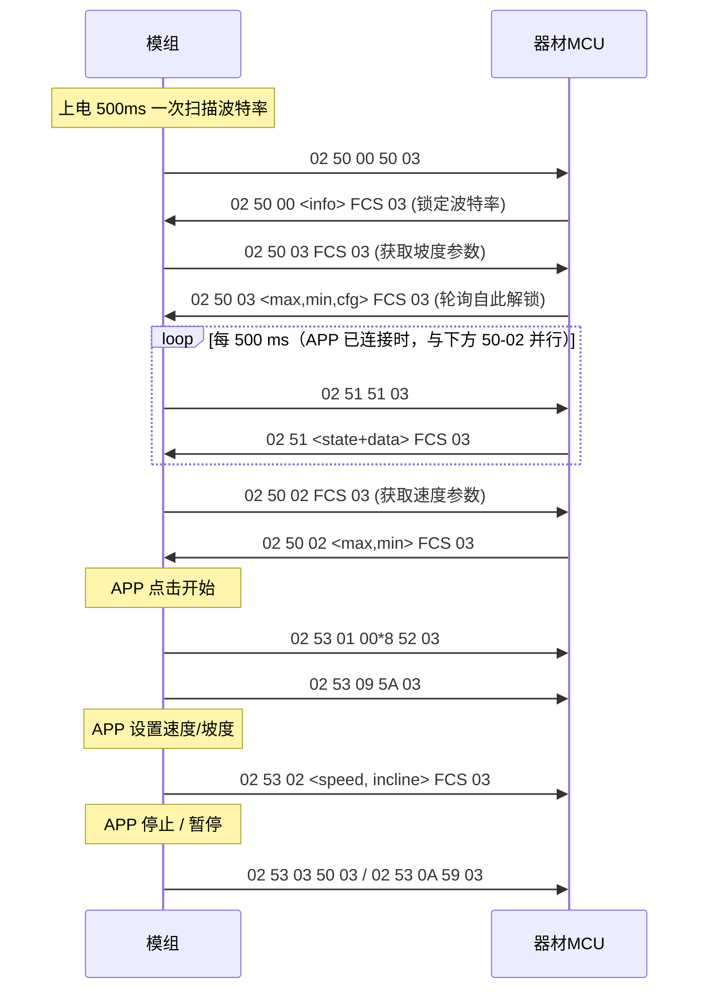

# 健身器材串口通信协议

**文档版本：V1.0**　　修订日期：2026-10-17

> 本协议用于 SDC-LE-05 / SDC-LE-02HS / SDC-LE-02HD 蓝牙模组与跑步机 / 健身车等器材 MCU 之间的串口通信。

---

## 1. 角色与拓扑

```
手机 APP ──BLE(FTMS/Device Info/自定义服务)── 本模组 ──UART── 跑步机/健身车 MCU
```

- 本模组 = 串口协议的**主动方**：周期性向器材 MCU 轮询状态、下发控制命令。
- 器材 MCU = 串口协议的**应答方**：收到命令后回帧，或按需主动上报状态。
- 模组把器材发来的合法帧透传到 BLE 通知特征 `FFF1`；APP 也可从 `FFF2` 写入原始字节，经模组直接下发到串口。
- 器材端应丢弃所有不符合第 3 章帧格式的字节，不要对长度不足或帧头帧尾不匹配的数据做任何响应。

---

## 2. 串口参数

| 项目 | 值 |
|---|---|
| 电平 | 见 2.1 电平兼容说明 |
| 串口引脚 | RX / TX（具体引脚定义见模组规格书） |
| 数据位 | 8 |
| 校验位 | 无 |
| 停止位 | **1** |
| 默认波特率 | 9600 |
| 流控 | 无 |

> 串口参数为 **9600 / 8 / N / 1**（8N1）。模组仅发送侧配置停止位，接收侧没有停止位配置项，按常规方式采样；器材按 8N1 配置即可正常互通。

### 2.1 电平兼容说明

| 模组型号 | 串口电平 |
|---|---|
| SDC-LE-05 | TTL 3.3 V，器材侧 TX 电平须为 3.3 V，不可直接接 5 V |
| SDC-LE-02HS | 3.3~5 V 兼容，可直接与 3.3 V 或 5 V 的器材 MCU 连接 |
| SDC-LE-02HD | 3.3~5 V 兼容，可直接与 3.3 V 或 5 V 的器材 MCU 连接 |

- 协议帧格式、命令与时序在三款型号上完全一致，仅电平范围不同。
- 5 V 器材接 SDC-LE-05 时需加电平转换，其余情况无需转换。
- 电源与电平为两套指标，供电电压请按各自规格书执行。

### 2.2 波特率自适应

上电后模组会按固定列表逐个尝试波特率并发送「获取设备信息」命令，器材 **必须在 500 ms 内回复** 才能锁定波特率：

```
4096, 4800, 9600, 14400, 19200, 38400, 57600, 115200
```

- 每 500 ms 切换一次，一圈约 4 s，未锁定则一直循环。
- 上电时序：初始化约 500 ms 后发出第一帧 `02 50 00 50 03`（此时工作在波特率列表第 1 项 `4096`）。若器材固定 9600，需等扫描列表走到第 3 项才能解出 `50-00`，即上电后约 1.5 s 收到第一帧有效请求。
- 锁定后先做「获取坡度参数」，收到应答即开始 500 ms 周期轮询；随后再做「获取速度参数」。
- 兼容建议：器材侧直接固定 9600 即可（`4096` 为非常规值，器材不应答属正常）；此时上电约 1.5 s 完成波特率锁定。
- 握手只在模组上电时进行一次：锁定后模组不会再次下发 `50-00` / `50-03` / `50-02`。若器材 MCU 中途复位而模组未复位，器材需自行恢复已协商的参数（或让模组重新上电），否则单位、坡度与速度范围将按旧值解释。

---

## 3. 帧格式

```
+------+--------+--------+------+----------+------+------+
| 0x02 | CMD    | [SCMD] | DATA |   FCS    | 0x03 |      |
+------+--------+--------+------+----------+------+------+
  帧头   命令码   子命令   数据   1 字节校验  帧尾
```

| 字段 | 说明 |
|---|---|
| `0x02` | 起始码（STX），固定 |
| `CMD` | 命令码，1 字节 |
| `SCMD` | 子命令码，1 字节，仅双字节命令存在 |
| `DATA` | 数据区，0~N 字节，多字节数值一律**小端**（低字节在前），除非单独说明 |
| `FCS` | 校验：`CMD`、`SCMD`、`DATA` 全部字节**逐字节异或**（不含 `0x02`、不含 `0x03`） |
| `0x03` | 结束码（ETX），固定 |

### 3.1 校验算法

```c
unsigned char fcs_calc(const unsigned char *data, size_t len)
{
    unsigned char fcs = 0;
    for (size_t i = 0; i < len; i++)
        fcs ^= data[i];
    return fcs;
}
// 传入 CMD 起始位置、长度 = 帧长 - 3（去掉 0x02、FCS、0x03 三个字节）
```

### 3.2 长度与约束

| 项目 | 限制 |
|---|---|
| 最小有效帧 | 4 字节（`0x02 CMD FCS 0x03`，无数据） |
| 单段接收 | 最多 **40 字节**，超出部分被截断 |
| 发送缓冲 | 40 字节/帧，超出部分被截断 |
| 转发到 APP | 帧长 ≤ 当前 BLE 单包上限（默认 20 字节，MTU 协商后放大）时才会转发 |
| 未识别命令 | 静默忽略（不回复错误帧） |

### 3.3 示例

| 含义 | 报文 |
|---|---|
| 模组 → 器材：获取设备信息 | `02 50 00 50 03` |
| 模组 → 器材：获取设备状态 | `02 51 51 03` |
| 器材 → 模组：运行中 5.2 km/h、坡度 3、1181 s、1057 m、74.7 kcal、步数 0、心率 0 | `02 51 03 34 03 9D 04 21 04 EB 02 00 00 00 00 30 03` |
| 模组 → 器材：启动 | `02 53 01 00 00 00 00 00 00 00 00 52 03` |
| 模组 → 器材：设置 6.0 km/h、坡度 5 | `02 53 02 3C 05 68 03` |
| 模组 → 器材：停止 | `02 53 03 50 03` |
| 模组 → 器材：恢复运动 | `02 53 09 5A 03` |
| 模组 → 器材：暂停 | `02 53 0A 59 03` |
| 器材 → 模组：请求模组重启 | `02 60 0A 6A 03` |

---

## 4. 时序 / 交互要求

### 4.1 模组侧调度节拍

| 任务 | 周期 | 说明 |
|---|---|---|
| 波特率扫描 | 500 ms | 未锁定时，每 500 ms 换一个波特率发 `50-00` |
| 参数获取 | 500 ms | 锁定后先发 `50-03`，未应答则每 500 ms 重发；收到应答后再发 `50-02`，同样重发至应答 |
| 状态轮询 `0x51` | 500 ms | **`50-03` 应答后立即开始**（此时 `50-02` 可能仍在重发），且仅当 APP（BLE）已连接时才发 |
| 发送帧 | 100 ms | 模组每 100 ms 取出一帧发出，发完才处理下一帧 |
| 接收解析 | 50 ms | 模组每 50 ms 处理一段接收数据 |
| 接收缓冲 | 5 段 | 缓冲满后新数据可能覆盖未处理数据，请遵守 4.2 的帧间隔 |

> 因此器材侧最关键的两个应答是 `50-00`（定位波特率）与 `50-03`（解锁状态轮询）。缺 `50-00` 模组会一直切换波特率；缺 `50-03` 则永远不会发出 `0x51`。缺 `50-02` 只会让速度范围被反复请求，轮询不受影响。

### 4.2 帧间隔建议

| 场景 | 建议 |
|---|---|
| 单帧应答 | 收到请求后 **≥ 10 ms** 再回复 |
| 连续多帧发送 | 帧间隔 ≥ 10 ms，平均每帧 ≥ 50 ms |
| 短突发（≤5 帧） | 突发后空闲 ≥ 250 ms |
| 单帧长度 | ≤ 40 字节（转发到 APP 建议 ≤ 20 字节） |

> 9600 bps、8N1 下每字节约 1.04 ms，一个 40 字节帧在线上约占用 42 ms，请对端留出裕量。

> 模组采用串口空闲超时判定帧边界：两帧贴合过近会被当作同一段数据，导致首尾校验失败而整包丢弃。

> 模组接收缓冲共 5 段，连续发送超过 5 帧且间隔过密时，最早的帧会被覆盖丢弃。

---

## 5. 命令总览

> 部分命令码会在两个方向出现（如 `0x50`、`0x44-C3`），方向由发起方决定，格式相同。下表按下发方向归类。

### 5.1 模组 → 器材（下行）

| CMD | SCMD | 名称 | 数据区 | 说明 |
|---|---|---|---|---|
| `0x50` | `0x00` | 获取设备信息 | 无 | 波特率锁定 + 能力协商入口，**器材必须应答** |
| `0x50` | `0x02` | 获取速度参数 | 无 | 应答见 6.2 |
| `0x50` | `0x03` | 获取坡度参数 | 无 | 应答见 6.3 |
| `0x51` | - | 获取设备状态/数据 | 无 | 500 ms 周期轮询，应答见 6.4 |
| `0x53` | `0x01` | 设备启动 | 8 字节，预留 | APP 点击「开始」时下发，表示启动；数据区为协议预留，器材可忽略 |
| `0x53` | `0x02` | 设置速度与坡度 | `[速度, 坡度]` | 速度 0.1 km/h（英制时 0.1 mph），坡度 1 %；两组值总是同时下发，未被调整的那个字段填器材当前值 |
| `0x53` | `0x03` | 停止 | 无 | FTMS 停止指令参数 = 0x01 |
| `0x53` | `0x09` | 恢复/开始运动 | 无 | APP 每次点「开始」时下发 |
| `0x53` | `0x0A` | 暂停 | 无 | FTMS 停止指令参数 = 0x02 |
| `0x53` | `0x9F` | 扩展数据 | 原始透传 | 扩展协议数据，`DATA[0..1]` 为 flags（小端），详见 6.8。**当前 APP 未使用，可忽略** |

> 注意：`0x53` 类命令为模组 **下发专用**，器材侧无需应答；器材上行请使用 5.2 节列出的命令。

### 5.2 器材 → 模组（上行）

| CMD | SCMD | 名称 | 数据区 | 说明 |
|---|---|---|---|---|
| `0x50` | `0x00` | 设备信息应答 | 4 或 6 字节 | 见 6.1，同时用于锁定波特率 |
| `0x50` | `0x02` | 速度参数应答 | 2 或 4 字节 | 见 6.2 |
| `0x50` | `0x03` | 坡度参数应答 | 3 字节 | 见 6.3 |
| `0x51` | - | 状态/数据应答 | 1 / 2 / 13 / 14 字节 | 见 6.4 |
| `0x44` | `0xC3` | 查询 APP 连接状态 | 无 | 模组回 1 字节：0=未连接，1=已连接 |
| `0x44` | `0xC5` | 查询 BLE 名称 | 无 | 回 ASCII 名称 |
| `0x44` | `0xC6` | 查询 BLE MAC | 无 | 回 6 字节 BD_ADDR |
| `0x44` | `0xC7` | 修改 BLE 名称 | 1~29 字节 ASCII | 成功回 1 字节 `0x00`，立即生效 |
| `0x44` | `0xC8` | 修改音频(经典蓝牙)名称 | 1~29 字节 ASCII | 成功回 1 字节 `0x00` |
| `0x44` | `0xC9` | 查询设备型号 | 无 | 回 ASCII 型号字符串 |
| `0x44` | `0xCA` | 查询 SN | 无 | 回 ASCII SN 字符串 |
| `0x44` | `0xCB` | 查询音频状态 | 无 | 回 2 字节 `[连接状态, 播放状态]` |
| `0x44` | `0xD1` | 查询音频(经典蓝牙)名称 | 无 | 回 ASCII 名称 |
| `0x60` | `0x0A` | 请求模组重启 | 无 | 模组立即复位重启，无应答 |
| `0x62` | `0x01` | 播放/暂停 | 无 | 无应答 |
| `0x62` | `0x02` | 停止播放 | 无 | 无应答 |
| `0x62` | `0x03` | 下一首 | 无 | 无应答 |
| `0x62` | `0x04` | 上一首 | 无 | 无应答 |
| `0x62` | `0x0B` | 音量 + | 无 | 无应答 |
| `0x62` | `0x0C` | 音量 - | 无 | 无应答 |

---

## 6. 应答与数据格式详解

本章对第 5 章出现的每条命令逐一说明。6.1~6.7 为器材需要回复或执行的命令，6.8 为模组下发命令的数据格式。

| 命令 | 方向 | 章节 |
|---|---|---|
| `50-00` 获取设备信息 | 模组 → 器材，器材应答 | 6.1 |
| `50-02` 获取速度参数 | 模组 → 器材，器材应答 | 6.2 |
| `50-03` 获取坡度参数 | 模组 → 器材，器材应答 | 6.3 |
| `51` 获取设备状态/数据 | 模组 → 器材，器材应答 | 6.4 |
| `44-C3` 查询 APP 连接状态 | 器材 → 模组，模组应答 | 6.5.1 |
| `44-C5` 查询 BLE 名称 | 器材 → 模组，模组应答 | 6.5.2 |
| `44-C6` 查询 BLE MAC | 器材 → 模组，模组应答 | 6.5.3 |
| `44-C7` 修改 BLE 名称 | 器材 → 模组，模组应答 | 6.5.4 |
| `44-D1` 查询音频名称 | 器材 → 模组，模组应答 | 6.5.5 |
| `44-C8` 修改音频名称 | 器材 → 模组，模组应答 | 6.5.6 |
| `44-C9` 查询设备型号 | 器材 → 模组，模组应答 | 6.5.7 |
| `44-CA` 查询 SN | 器材 → 模组，模组应答 | 6.5.8 |
| `44-CB` 查询音频状态 | 器材 → 模组，模组应答 | 6.5.9 |
| `60-0A` 请求模组重启 | 器材 → 模组，无应答 | 6.6 |
| `62-01`~`62-0C` 音频控制 | 器材 → 模组，无应答 | 6.7 |
| `53-9F` 扩展数据 | 模组 → 器材，无应答 | 6.8 |

### 6.1 `50-00` 设备信息

数据区支持两种长度：

| 长度 | 字段 |
|---|---|
| 4 | `[厂商码 W][机型码 W]` |
| 6 | `[类型 W][厂商码 W][机型码 W]` |

- 全部小端。
- 器材回复此帧即视为波特率锁定成功。
- 示例（厂商码 0x1234，机型码 0x5678）：`02 50 00 34 12 78 56 58 03`

### 6.2 `50-02` 速度参数

| 长度 | 字段 |
|---|---|
| 2 | `[最大速度(B)][最小速度(B)]` |
| 4 | `[最大速度(W)][最小速度(W)]` |

- **单位：0.1 km/h**（例：`0x78` = 120 → 12.0 km/h）；若 6.3 节 `bit0 = 1`（英制），则单位变为 **0.1 mph**。
- 模组内部统一换算成公制 FTMS 数值（速度 ×10 → 0.01 km/h，英制自动 ×1.61 转公里）。
- 最小增量由模组按 0.1 km/h 固定处理，无需器材上报；**推荐使用 2 字节长度应答**，4 字节长度下模组不保证最小增量字段的值。
- 示例（最大 12.0、最小 1.0）：`02 50 02 78 0A 20 03`

### 6.3 `50-03` 坡度参数

数据区固定 3 字节：

| 偏移 | 字段 | 单位 |
|---|---|---|
| 0 | 最大坡度 | 1 % |
| 1 | 最小坡度 | 1 % |
| 2 | 配置参数表 | 位域，见下 |

配置参数表 `DATA[2]`：

| 位 | 含义 |
|---|---|
| bit0 | 计量单位：0 = 公制（km / km/h），1 = 英制（mile / mph） |
| bit1 | 支持暂停 |
| bit2 | 支持心率预警 |
| bit3~7 | 保留，填 0 |

> `bit0` 是**全局单位开关**：置 1 后，6.2 节的速度参数、6.4 节的速度与距离字段均按英制（0.1 mph、0.001 / 0.01 mile）解释，模组内部再换算为公制 FTMS 数值。

- 若最大坡度 ≠ 最小坡度，模组会向 APP 声明支持坡度控制。
- 心率范围由模组固定声明为 0~250，步进 1，无需器材上报。
- 示例（0~15%，公制）：`02 50 03 0F 00 00 5C 03`

### 6.4 `51` 设备状态与数据

`DATA[0]` 为设备状态：

| 值 | 状态 |
|---|---|
| `0x00` | 待机 Idle |
| `0x01` | 停机 Stop |
| `0x02` | 倒计时启动 |
| `0x03` | 运行中 Running |
| `0x04` | 减速停止 |
| `0x05` | 故障 |
| `0x06` | 禁用 |
| `0x0A` | 暂停 |

按状态选择数据长度：

#### (a) 待机 —— 长度 1

`[0x00]`

- 模组收到后清空已保存的运动数据。
- 待机也允许携带完整数据（长度 13/14），部分器材待机时仍上报数据。

#### (b) 倒计时启动 —— 长度 2

`[0x02][倒计时秒数]`

#### (c) 故障 —— 长度 2

`[0x05][故障码]`

#### (d) 禁用 —— 长度 2

`[0x06][禁用码]`，禁用码：1 = 安全锁脱落，2 = 设备睡眠。

#### (e) 停机 / 运行中 / 减速停止 / 暂停 —— 长度 13（8 位速度）

| 偏移 | 字段 | 类型 | 单位 |
|---|---|---|---|
| 0 | 状态 | B | 见上表 |
| 1 | 速度 | B | **0.1 km/h**；英制时为 **0.1 mph**（见 6.3 `bit0`） |
| 2 | 坡度 | B | 1 % |
| 3~4 | 时间 | W | s |
| 5~6 | 距离 | W | 见下方说明 |
| 7~8 | 热量 | W | **0.1 kcal** |
| 9~10 | 步数 | W | 步 |
| 11 | 心率 | B | 次/分，无该数据时填 0 |
| 12 | 预留 | B | 填 0 |

#### (f) 停机 / 运行中 / 减速停止 / 暂停 —— 长度 14（16 位速度）

与 (e) 相同，仅速度变为 2 字节小端（0.1 km/h，英制时 0.1 mph），其后字段整体后移 1 字节。

#### 距离字段说明

- `bit15`（`0x8000`）为**分辨率标志**，低 15 位为有效数值：
  - `bit15 = 0`：单位 0.001（公制为米，英制为 mile）；
  - `bit15 = 1`：单位 0.01（公制为 10 米，英制为 0.01 mile）。
- 距离单位随 6.3 节 `bit0` 配置：公制按 km，英制按 mile，器材不要换算成公制后再填。
- 模组统一换算为米后上报 FTMS：公制按上表系数换算；英制 `bit15 = 0` 时 ×1.61，`bit15 = 1` 时 ×16.1。
- 例（公制）：`0x0421` → 1057 → 1057 m ≈ 1.057 km。

### 6.5 `44-xx` 信息服务

本组命令均为器材发起查询/设置，模组应答。请求帧的 DATA 区必须为空（`44-C7`、`44-C8` 除外），否则模组静默丢弃。

#### 6.5.1 `44-C3` 查询 APP 连接状态

| 项 | 内容 |
|---|---|
| 请求 DATA | 无 |
| 应答 DATA | 1 字节：`0x00` = 未连接，`0x01` = 已连接 |
| 判定依据 | APP 已连接或已配对均视为已连接 |

```
请求：02 44 C3 87 03
应答：02 44 C3 01 86 03      // APP 已连接
```

此外，APP 连接或断开时模组会**主动上报**一次，器材需能异步接收；该主动上报与 `0x51` 轮询同时解锁。

#### 6.5.2 `44-C5` 查询 BLE 名称

| 项 | 内容 |
|---|---|
| 请求 DATA | 无 |
| 应答 DATA | ASCII 字符串，长度 = 实际字符数（不含结束符） |

```
请求：02 44 C5 81 03
应答：02 44 C5 47 59 4D 2D 44 35 45 36 FD 03   // "GYM-D5E6"
```

出厂默认名称为「前缀-XXXX」：前缀由模组出厂配置决定，`XXXX` 为 `44-C6` 应答中 `DATA[4]`、`DATA[5]` 的十六进制大写；经 `44-C7` 修改后返回设定值。

#### 6.5.3 `44-C6` 查询 BLE MAC

| 项 | 内容 |
|---|---|
| 请求 DATA | 无 |
| 应答 DATA | 6 字节 BD_ADDR，`DATA[0]` 为首字节，顺序与手机扫描到的 MAC 显示顺序一致 |

```
请求：02 44 C6 82 03
应答：02 44 C6 A1 A2 B3 C4 D5 E6 C5 03
```

上例对应手机扫描到的 MAC 为 `A1:A2:B3:C4:D5:E6`。

#### 6.5.4 `44-C7` 修改 BLE 名称

| 项 | 内容 |
|---|---|
| 请求 DATA | 1~29 字节 ASCII，即新名称（超过 29 字节会被截断） |
| 应答 DATA | 1 字节 `0x00` 表示成功 |
| 异常 | DATA 为空或超过 30 字节时模组静默丢弃，不应答 |

```
请求：02 44 C7 47 59 4D 2D 44 35 45 36 FF 03   // 设为 "GYM-D5E6"
应答：02 44 C7 00 83 03
```

写入后立即生效并刷新 BLE 广播，无需重启。名称长度受 BLE 广播包容量限制，建议不超过 20 字节。

#### 6.5.5 `44-D1` 查询音频（经典蓝牙）名称

| 项 | 内容 |
|---|---|
| 请求 DATA | 无 |
| 应答 DATA | ASCII 字符串，长度 = 实际字符数 |

```
请求：02 44 D1 95 03
应答：02 44 D1 47 59 4D 2D 44 35 45 36 5F 41 75 64 69 6F E0 03   // "GYM-D5E6_Audio"
```

出厂默认名称为「前缀-XXXX_Audio」，后缀规则与 `44-C5` 相同，经 `44-C8` 修改后返回设定值。

#### 6.5.6 `44-C8` 修改音频名称

| 项 | 内容 |
|---|---|
| 请求 DATA | 1~29 字节 ASCII，即新名称（超过 29 字节会被截断） |
| 应答 DATA | 1 字节 `0x00` 表示成功 |
| 异常 | DATA 为空或超过 30 字节时模组静默丢弃，不应答 |

```
请求：02 44 C8 47 59 4D 2D 44 35 45 36 5F 41 75 64 69 6F F9 03
应答：02 44 C8 00 8C 03
```

写入后立即生效，无需重启。

#### 6.5.7 `44-C9` 查询设备型号

| 项 | 内容 |
|---|---|
| 请求 DATA | 无 |
| 应答 DATA | ASCII 字符串，为模组硬件型号的固定值，长度 = 实际字符数 |

```
请求：02 44 C9 8D 03
应答：02 44 C9 53 44 43 2D 4C 45 2D 30 35 D5 03   // "SDC-LE-05"
```

#### 6.5.8 `44-CA` 查询 SN

| 项 | 内容 |
|---|---|
| 请求 DATA | 无 |
| 应答 DATA | ASCII 字符串，固定 17 字符 |

SN 由模组出厂参数生成，与器材无关，结构如下：

| 偏移 | 长度 | 含义 |
|---|---|---|
| 0~1 | 2 | 品类码（`RM` = 跑步机，`IN` = 健身车） |
| 2~7 | 6 | 厂家编码，未配置时全为 `0` |
| 8~9 | 2 | 生产年份（两位） |
| 10 | 1 | 生产月份（1~9 为数字，10~12 为 `A`~`C`） |
| 11~16 | 6 | `44-C6` 应答中 `DATA[3]`、`DATA[4]`、`DATA[5]` 依次转十六进制大写 |

```
请求：02 44 CA 8E 03
应答：02 44 CA 52 4D 30 30 30 30 30 30 32 35 41 43 34 44 35 45 36 A2 03
      // "RM00000025AC4D5E6"（17 字符，与上例 MAC 对应）
```

#### 6.5.9 `44-CB` 查询音频状态

| 项 | 内容 |
|---|---|
| 请求 DATA | 无 |
| 应答 DATA | 2 字节：`[连接状态][播放状态]` |

| 字节 | 取值 | 含义 |
|---|---|---|
| DATA[0] | `0x00` | 音频未连接 |
| DATA[0] | `0x01` | 音频已连接 |
| DATA[1] | `0x00` | 未播放 |
| DATA[1] | `0x01` | 正在播放 |

```
请求：02 44 CB 8F 03
应答：02 44 CB 01 01 8F 03      // 已连接且正在播放
```

### 6.6 `60-0A` 请求模组重启

| 项 | 内容 |
|---|---|
| 请求 DATA | 无（携带数据也会被忽略） |
| 应答 | 无 |

```
02 60 0A 6A 03
```

模组收到后立即复位，无应答，此前的 BLE 连接会断开。复位期间串口无任何输出，该时长取决于模组芯片启动，协议不做约定；复位完成后模组从零开始重新握手（同 2.2 节的上电时序），器材需重新应答 `50-00` / `50-03` / `50-02`。

### 6.7 `62-xx` 音频控制

| CMD-SCMD | 功能 | 示例帧 |
|---|---|---|
| `62-01` | 播放 / 暂停（切换） | `02 62 01 63 03` |
| `62-02` | 停止播放 | `02 62 02 60 03` |
| `62-03` | 下一首 | `02 62 03 61 03` |
| `62-04` | 上一首 | `02 62 04 66 03` |
| `62-0B` | 音量 + | `02 62 0B 69 03` |
| `62-0C` | 音量 - | `02 62 0C 6E 03` |

- 以上命令 DATA 区必须为空，携带数据时模组静默丢弃。
- 全部为**无应答**的单向控制指令；执行结果通过 `44-CB` 查询音频状态获得。
- 音频未连接时发送，模组不报错也不执行。
- 音量范围由模组内部限制，到达上下限后继续加减无效。

### 6.8 `53-9F` 扩展数据（模组 → 器材）

由 APP 的扩展特征值写入后整段下发，`DATA` 由 2 字节 flags 加若干字段组成，**总长度必须为 3~35 字节**（整帧不超过 40 字节）。

**flags（2 字节，小端）**

| 位 | 含义 | 对应后续字段 |
|---|---|---|
| Bit0 | 参数包含解锁码 | Unlock Code |
| Bit1 | 参数包含心率 | Heart Rate |
| Bit2 | 参数包含总卡路里 | Total Energy |
| Bit3 | 参数包含动态卡路里 | Dynamic Energy |
| Bit4 | 参数包含计步 | Step Count |
| Bit5 | 参数包含运行时间 | Running Time |
| Bit6 | 参数包含 RGB 颜色码 | RGB Color |
| Bit7 | 参数包含里程 | Distance |
| Bit8~Bit15 | 保留 | 无 |

**字段排列**

各字段按 flags 从 Bit0 起逐位顺序拼接，仅当对应位置 1 时才出现：

| 字段 | 格式 | 长度 | 说明 |
|---|---|---|---|
| Unlock Code | — | 6 字节 | 厂家自定义解锁码，由 `0`~`F` 的 6 个十六进制字符组成 |
| Heart Rate | 无符号 | 1 字节 | 心率值 |
| Total Energy | 无符号，小端 | 2 字节 | 总卡路里 |
| Dynamic Energy | 无符号，小端 | 2 字节 | 动态卡路里 |
| Step Count | 无符号，小端 | 2 字节 | 实时步数 |
| Running Time | 无符号，小端 | 2 字节 | 运行时间，单位秒 |
| RGB Color | 3 字节 | 3 字节 | 依次为 G、B、R 三通道亮度值 |
| Distance | 无符号，小端 24 位 | 3 字节 | 运动里程，单位米 |

例：含心率 120、总卡路里 300 时，`flags = 0x0006`，完整帧为：

```
02 53 9F 06 00 78 2C 01 9F 03
```

**约定**

- 保留位填 0，模组会忽略未定义位对应的数据。
- 长度 ≤ 2 字节时模组不会下发。
- 器材若不需要该功能，可直接丢弃此帧（无应答）。
- **当前 APP 尚未使用该扩展数据**：APP 不会主动写入此特征值，模组也不会主动下发 `53-9F`。上述字段定义仅为协议预留，器材收到时按上表解析即可，未收到属正常现象。

---

## 7. 典型交互流程



---

## 8. 关键注意事项

- [ ] 确认模组型号与电平匹配：SDC-LE-05 为 3.3 V，SDC-LE-02HS / SDC-LE-02HD 支持 3.3~5 V。
- [ ] 8 数据位、无校验、**1 停止位**，波特率与模组锁定值一致。
- [ ] 忽略任何不符合帧格式的数据（长度不足、帧头帧尾不匹配、FCS 错误）。
- [ ] 收到 `50-00` 必须应答，否则模组会持续切换波特率（每 500 ms）。
- [ ] 收到 `50-03` 必须应答，否则模组永远不会开始 `0x51` 轮询；`50-02` 也需应答，否则速度范围会被反复请求。
- [ ] `50-03` 应答后，**只有 APP 连上 BLE 才会收到 `0x51` 轮询**；调试时先用手机 BLE 连接。
- [ ] FCS 为 `CMD` 起至 `DATA` 末字节的异或，勿把 `0x02/0x03` 计入。
- [ ] 所有多字节字段小端；`51` 的距离字段注意 `bit15` 分辨率标志。
- [ ] `50-03` 的 `bit0` 决定全局单位，切换英制后速度/距离按 mile 解释。
- [ ] 帧长控制在 40 字节内，转发到 APP 建议 ≤ 20 字节。
- [ ] 帧间至少留 10 ms 间隔，避免两帧被合并成一段导致整包丢弃。
- [ ] 状态变化时可用 `51` 主动上报；模组也在 500 ms 轮询，二者不冲突。
- [ ] 连续发送的帧数不超过 5 帧，且遵守 4.2 的帧间隔要求。
- [ ] 握手只在模组上电时做一次；器材 MCU 单独复位后不会重新收到 `50-00/50-03/50-02`，需自行恢复参数或让模组一起复位。
- [ ] 未识别命令静默忽略，不要依赖错误应答做重传。
- [ ] 名称类命令长度 1~29 字节，空名称会被拒绝。

---

## 修订记录

| 文档版本 | 修订日期 | 修订内容 |
|---|---|---|
| V1.0 | 2026-10-17 | 首次发布 |
